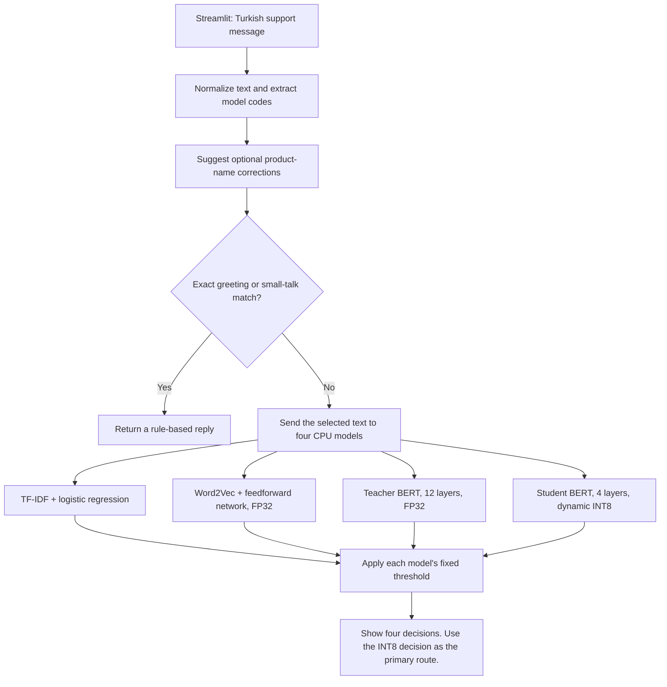

# Architecture and Technique Map

| Area | Implementation |
| --- | --- |
| A · Neural networks | Word2Vec trained on the training messages. Mean word vectors feed a 50 → 64 → 5 network trained with SGD and backpropagation. |
| B · Classical NLP | Unicode NFC and whitespace normalization, regex model-code extraction, edit-distance product-name suggestions, exact-match ELIZA-style replies, and TF-IDF with logistic regression. |
| C · Transformers | A 12-layer Turkish BERTurk teacher fine-tuned for five support categories, with WordPiece tokenization. |
| D · Efficient models | Distillation from a frozen teacher to a four-layer student using cross-entropy and temperature-scaled KL divergence. Dynamic INT8 quantization applies to linear layers. The benchmark compares model size, latency, and accuracy. |

## Live request flow

A prediction below its model's threshold is routed to a human agent. Users can choose whether to apply the spelling suggestions before classification. The app resolves team names from each model's saved class order. The 60 intent IDs from the initial MASSIVE experiment are separate from the five support categories used here.

## Training and evaluation

Training ran in Colab. The student was initialized from teacher layers 0, 3, 7, and 11 (zero-based indices). Distillation used a temperature of 2 and a KL loss weight of 0.5. Validation data determined the selected epochs and rejection thresholds. The INT8 student uses the FP32 student's threshold. The test set was evaluated with those thresholds fixed.

The FP32 student appears in the benchmark as an additional comparison. The live interface shows the four models in the diagram. Dynamic INT8 quantization covers linear layers, and the embeddings remain FP32.

The archived test used raw text inputs. The live app adds regex normalization and optional edit-distance correction, so the archived metrics cover the earlier evaluation pipeline.
