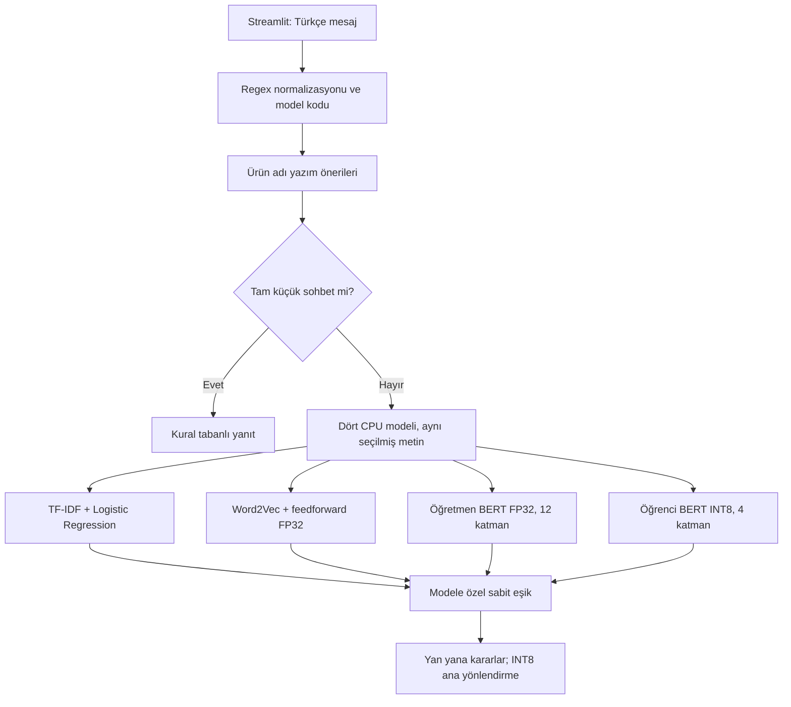

# Teknik harita ve mimari

| Alan | Bileşen |
|---|---|
| A | Eğitim mesajlarından Word2Vec; ortalama vektör → 50/64/5 feedforward ağ; SGD/backprop |
| B | Regex NFC/boşluk düzeni ve model kodu çıkarma; edit distance ürün önerileri; tam eşleşen ELIZA tarzı yanıt; TF-IDF + Logistic Regression |
| C | Türkçe BERTurk 12 katman, beş sınıfa fine-tuning, WordPiece tokenizer |
| D | Dondurulmuş öğretmen ile 4 katmanlı öğrenciye CE + sıcaklıklı KL distillation; Linear katmanlarına dinamik INT8; boyut/gecikme/doğruluk karşılaştırması |

Eğitim uygulama dışında Colab'da yapıldı. Öğrenci, öğretmenin 0/3/7/11 indeksli katmanlarından başlatıldı; sıcaklık 2, KL ağırlığı 0.5. Validation ile epoch ve red eşikleri seçildi. INT8 eşiği FP32 öğrenciden alındı. Test üzerinde sonradan eşik seçimi yok.

Model boyutu/latency raporundaki FP32 öğrenci yalnızca ek deney satırıdır; canlı dört sütunlu arayüzde yer almaz. Dinamik INT8 sadece Linear katmanlarını kapsar; embedding katmanları FP32 kalır. Ekip isimleri gerçek label sırasından gelir; MASSIVE'deki 60 eski ID ile eşleştirme yapılmaz.

Eski final deneyindeki ham metin girişleri, uygulamanın yeni regex ve opsiyonel edit-distance yolundan geçmedi. Sonuç tablosu ile uygulama akışının kapsam farkı sunumda da söylenmelidir.
